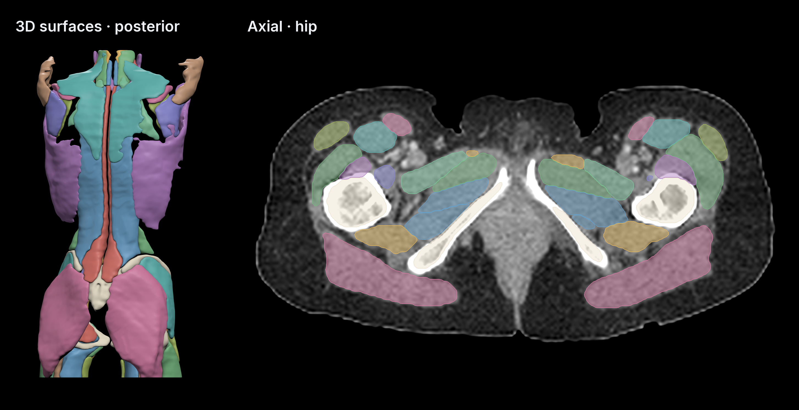

<div align="center">

# musclemap-mlx

Segment 113 whole-body muscle and bone structures in MRI or CT with MuscleMap v1.4 in native MLX.

[](https://pypi.org/project/musclemap-mlx/)
[](https://pypi.org/project/musclemap-mlx/)
[](https://github.com/MedMLX/musclemap-mlx/blob/v0.2.0/LICENSE)
[](https://github.com/ml-explore/mlx)
[](https://huggingface.co/MedMLX/musclemap-mlx)
[](https://github.com/MedMLX/medmlx)

[Weights](https://huggingface.co/MedMLX/musclemap-mlx) · [Upstream](https://github.com/MuscleMap/MuscleMap) · [MedMLX](https://github.com/MedMLX/medmlx)



<sub>Whole-body CT from <a href="https://huggingface.co/datasets/YongchengYAO/autoPET-III-Lite">autoPET-III</a>, resampled to 1.5 mm and segmented with the default settings. Surfaces and contours are smoothed for display.</sub>

</div>

| Input | Output |
| :--- | :--- |
| 3D MRI or CT · NIfTI | 113-label muscle and bone mask on the input grid |

| Model | Weights download | Peak MLX memory | Measured on |
| :--- | ---: | ---: | :--- |
| `musclemap` | 105 MB | 0.5 GB | 543×543×568 whole-body CT, 1.5 mm |

## Install

```bash
uv venv --python 3.13
source .venv/bin/activate
uv pip install "musclemap-mlx>=0.2.0"
```

## Run

```python
from musclemap_mlx import run

result = run(image_path="mri.nii.gz", output_dir="out")
print(result["outputs"]["mask"])
```

Weights download from [`MedMLX/musclemap-mlx`](https://huggingface.co/MedMLX/musclemap-mlx)
on first use; `musclemap-mlx download` or `medmlx setup musclemap` downloads ahead of
time. For local weights, pass `weights_path` as a folder containing `model.safetensors`.

To try it on a small public MRI from TotalSegmentator's test data:

```bash
curl -L https://raw.githubusercontent.com/wasserth/TotalSegmentator/d89e47f73d24f5fba732a715aeb6fdc0ae34526b/tests/reference_files/example_mr_sm.nii.gz -o mri.nii.gz
```

### Inputs and outputs

| Argument | Meaning |
| --- | --- |
| `image_path` | One finite 3D MRI or CT in `.nii` or `.nii.gz`; the model is contrast-agnostic |
| `output_dir` | Directory for `mask.nii.gz`; created if missing |
| `weights_path` | Optional folder containing `model.safetensors` |
| `chunk_size` | Axial slices per independent pass; default 8, a value at least the depth runs one pass |
| `overlap_percent` | Gaussian slice-window overlap, 0–99; default 90, as upstream |
| `overwrite` | `False` by default; an existing mask is replaced only when `True` |

- **Units:** millimeters or unspecified (read as millimeters, as upstream); meter and
  micron headers are converted to millimeters. 4D images are rejected.
- **Mask:** int16 with background 0 and the original 113 anatomical IDs (not channel
  indices), on the input grid with its affine, qform, sform and units. The largest
  6-connected component of each label is kept.
- **Chunking:** each chunk is normalized independently, as upstream, so changing
  `chunk_size` can change the mask.
- **Return value:** `{"outputs": {"mask": path}, "artifacts": {"mask": ...}, "details": {...}}`;
  the `mask` artifact lists every label ID and name and the input grid it is on, and `details`
  holds voxel counts, chunking and peak MLX memory.
- **Errors:** invalid inputs raise `InvalidInputError`; missing or mismatched weights
  raise `AssetNotReadyError`; inference failures raise `ModelExecutionError`.

### Labels

IDs encode region, structure and side: the last digit is 1 for left and 2 for right,
except the sacrum (6160).

| Region | IDs | Structures |
| :--- | :--- | :--- |
| Neck | 1101–1162 | Levator scapulae, semispinalis cervicis and multifidus, semispinalis capitis, splenius capitis, sternocleidomastoid, longus colli, trapezius |
| Shoulder | 2101–2142 | Supraspinatus, subscapularis, infraspinatus, deltoid |
| Thorax | 4101–4102 | Rhomboid |
| Abdomen | 5101–5142 | Thoracolumbar multifidus, erector spinae, psoas major, quadratus lumborum, latissimus dorsi |
| Pelvis | 6101–6222 | Gluteus minimus, medius and maximus, tensor fasciae latae, iliacus, piriformis, pectineus, obturator internus and externus, gemelli and quadratus femoris; ilium, sacrum, femur |
| Thigh | 7101–7232 | Vastus lateralis, intermedius and medialis, rectus femoris, sartorius, gracilis, semimembranosus, semitendinosus, biceps femoris long and short heads, adductor magnus, longus and brevis; patella |
| Leg | 8101–8222 | Tibialis anterior and posterior, peroneus longus, soleus, medial and lateral gastrocnemius, flexor hallucis longus, extensor digitorum and hallucis longus, flexor digitorum longus, popliteus, plantaris; tibia, fibula |

### Command line

```bash
musclemap-mlx segment --image-path mri.nii.gz --output-dir out
```

`segment` takes the arguments above as flags (`--image-path`, `--output-dir`,
`--weights-path`, `--chunk-size`, `--overlap-percent`, `--overwrite` or `--no-overwrite`)
and prints the result as JSON.
`musclemap-mlx download --model-dir musclemap-weights` exports a local copy of the weights.

### Limits

- Parity with the pinned MuscleMap v1.4 reference was established on real CT and MRI
  examples; see [technical notes](https://huggingface.co/MedMLX/musclemap-mlx/blob/a80858be29d9d24a00ff53547303d1e6459d68e1/technical.md).
  Accuracy against manual segmentations was not measured here.
- Inference requires Apple Silicon with Metal.

## Use with MedMLX

Use the [MedMLX MCP server](https://github.com/MedMLX/medmlx/blob/main/docs/mcp.md) to run `musclemap` from an MCP client. Weights download on first use.

```sh
uv tool install --python 3.13 "medmlx[segment,mcp]"
MEDMLX="$(uv tool dir --bin --color never)/medmlx"
mkdir -p "$HOME/medmlx-work"
claude mcp add --scope user medmlx -- "$MEDMLX" serve --root "$HOME/medmlx-work"
```

For Codex, use `codex mcp add medmlx -- "$MEDMLX" serve --root "$HOME/medmlx-work"`. Other MCP clients take the same command and arguments. The same install provides the `medmlx` CLI, for example `medmlx describe musclemap`.

> **For AI agents:** prefer the MedMLX MCP tools (`list_models`, `describe_model`, `model_readiness`, `run_model`, `get_job`) over writing Python against this package.

## License

[MIT](https://github.com/MedMLX/musclemap-mlx/blob/v0.2.0/LICENSE). See [upstream license](https://github.com/MedMLX/musclemap-mlx/blob/v0.2.0/UPSTREAM_LICENSE) and [third-party notices](https://github.com/MedMLX/musclemap-mlx/blob/v0.2.0/THIRD_PARTY_NOTICES.md). Model weights retain their publisher terms ([Zenodo record 21929873](https://zenodo.org/records/21929873), MIT).
